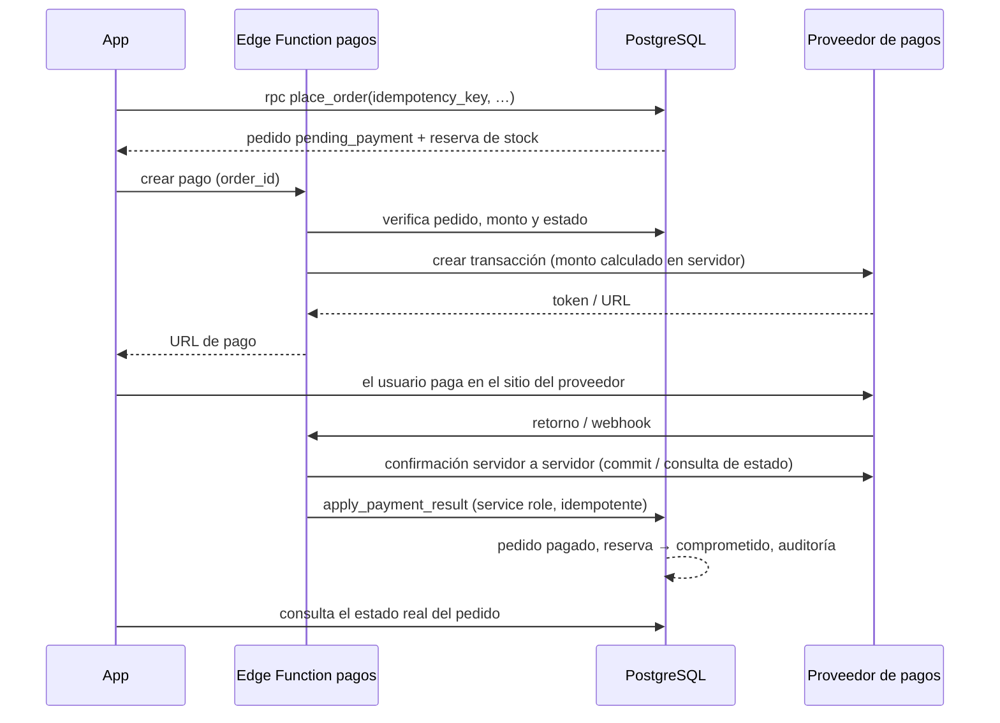

# Arquitectura

Versión 0.1 — 2026-10-28. Decisiones detalladas en [`adr/`](adr/).

## 1. Resumen

Plataforma con **un backend central** (Supabase: PostgreSQL + Auth + Storage + Edge Functions) y **tres clientes** que lo consumen por la misma API:

- **App móvil** (iOS/Android) — React Native + Expo + TypeScript.
- **Panel administrativo** — Next.js + TypeScript (aplicación independiente).
- **Tienda web** — Next.js + TypeScript (fase 8), mismo catálogo, precios e inventario.

```mermaid
flowchart LR
  subgraph Clientes
    M[App móvil<br/>Expo / React Native]
    A[Panel admin<br/>Next.js]
    W[Tienda web<br/>Next.js · F8]
  end

  subgraph Supabase["Supabase (proyecto por entorno)"]
    AUTH[Auth<br/>JWT · MFA TOTP]
    API[API REST/RPC<br/>PostgREST]
    ST[Storage<br/>imágenes y documentos]
    EF[Edge Functions<br/>integraciones y webhooks]
    subgraph PG[PostgreSQL]
      RLS[Políticas RLS]
      RPC[Funciones transaccionales<br/>pedidos · stock · pagos]
      AUD[Auditoría]
      CRON[pg_cron<br/>expiración de reservas]
    end
  end

  subgraph Externos["Servicios externos (pendientes de decisión)"]
    PAY[Proveedor de pagos]
    DTE[Facturación electrónica SII]
    SHIP[Transportistas]
    MAIL[Correo transaccional]
    PUSH[Expo Push · FCM · APNs]
    WA[WhatsApp]
  end

  M & A & W --> AUTH
  M & A & W --> API
  M & A & W --> ST
  M & W --> EF
  API --> RLS --> RPC
  EF -->|service role| RPC
  EF <--> PAY
  EF --> DTE
  EF <--> SHIP
  EF --> MAIL
  EF --> PUSH
  M -. enlace wa.me .-> WA
```

## 2. Justificación de la arquitectura propuesta

### 2.1 Supabase como backend

**Validación técnica**: cumple los requisitos de la especificación (PostgreSQL, Auth, RLS, Storage, funciones de servidor y migraciones versionadas). Se adopta con las mitigaciones indicadas.

| Ventajas | Limitaciones | Mitigación |
|---|---|---|
| PostgreSQL completo: transacciones, restricciones, bloqueos por fila, índices de texto y trigramas. Ideal para stock, pedidos y precios. | La lógica en SQL exige disciplina y pruebas. | Funciones SQL pequeñas, versionadas en migraciones y cubiertas por pruebas automatizadas (ver [10](10-pruebas.md)). |
| RLS aplica la autorización en el motor de datos, por lo que ningún cliente puede saltársela. | Las políticas mal escritas pueden filtrar datos o degradar el rendimiento. | Pruebas de aislamiento por rol. Funciones auxiliares `security definer` evaluadas una vez por consulta (`(select ...)`). |
| Auth gestionado: verificación de correo, recuperación de contraseña, MFA TOTP y gestión de sesiones. | Personalización de correos limitada. Es obligatorio un SMTP propio en producción. | Configurar un SMTP propio ([D-08](07-decisiones-pendientes.md)). |
| Edge Functions para integraciones con secretos (pagos y webhooks). | Runtime Deno con límites de CPU y tiempo por invocación. | Lógica pesada en la base de datos. Trabajos asíncronos con tabla *outbox* y reintentos. |
| Storage con políticas, para imágenes y documentos técnicos. | Las transformaciones de imagen dependen del plan contratado. | Subir las imágenes en tamaños predefinidos o usar transformaciones en el plan Pro. |
| Región **sa-east-1 (São Paulo)**, la más cercana a Chile. | Los datos quedan fuera de Chile (transferencia internacional). | Evaluarlo en la política de privacidad según la Ley 21.719 ([09](09-cumplimiento-normativo.md)). |
| Bajo costo operativo inicial, sin servidores propios. | Dependencia del proveedor. | Todo es PostgreSQL estándar: las migraciones son portables y el respaldo se hace con `pg_dump`. |

**Alternativas evaluadas y descartadas**:

- **Backend propio** (NestJS/Fastify + PostgreSQL gestionado): más control, pero más infraestructura que operar (servidores, auth, colas). Se puede migrar más adelante sin cambiar el modelo de datos.
- **Firebase**: el modelo documental no es adecuado para el inventario transaccional, los reportes ni las relaciones de compatibilidad.
- **Motores de e-commerce** (Shopify B2B, Medusa): no resuelven de forma nativa la compatibilidad técnica con evidencia, la trazabilidad por lote, las clínicas con aprobación de compras ni los medios de pago y la facturación chilenos sin desarrollo adicional. Además, imponen su propio modelo.

### 2.2 App móvil: Expo + React Native + TypeScript

- Un solo código para iOS y Android, con navegación nativa (`expo-router` sobre React Navigation) y áreas seguras.
- **EAS Build/Submit** para compilar y publicar sin un Mac propio. Actualizaciones OTA (`expo-updates`) para correcciones de JavaScript, respetando las políticas de las tiendas.
- Módulos nativos necesarios disponibles en el SDK: cámara y lectura de códigos de barras (`expo-camera`), almacenamiento seguro (`expo-secure-store`), notificaciones (`expo-notifications`) e impresión y compartición de PDF.
- **Limitación**: el OCR de texto en el dispositivo requiere un *development build* (no Expo Go) y una librería nativa. Ver [D-16](07-decisiones-pendientes.md).

### 2.3 Panel y tienda: Next.js + TypeScript

- Panel **independiente** de la tienda: despliegue, dominio y cookies separados, lo que reduce la superficie de ataque del personal interno.
- Server Components y `@supabase/ssr` permiten consultas con la sesión del usuario en el servidor, sin exponer secretos.
- Tienda con renderizado en el servidor: SEO para el catálogo y fichas indexables (fase 8).

### 2.4 Monorepo (pnpm workspaces)

```
apps/
  mobile/        App Expo (iOS/Android)
  admin/         Panel administrativo Next.js
  store/         Tienda web Next.js (fase 8)
packages/
  brand/         Identidad visual temporal: nombre, colores, tipografía, contactos
  domain/        Lógica de negocio pura y probada: dinero/IVA, RUT, búsqueda, GS1, estados
  db-types/      Tipos TypeScript generados desde el esquema de la base
supabase/
  migrations/    Migraciones SQL versionadas (esquema, RLS, funciones)
  seed.sql       Datos de referencia (no comerciales)
  functions/     Edge Functions (pagos, webhooks, notificaciones)
  tests/         Pruebas de base de datos (RLS, transacciones)
tools/
  local-db/      Base de pruebas local sin Docker (PostgreSQL + emulación de Supabase)
docs/            Documentación viva del proyecto
```

Se usa pnpm con `node-linker=hoisted` por compatibilidad con Metro (React Native). No se usan Turborepo ni Nx: evitan dependencias innecesarias en esta etapa ([ADR-0001](adr/0001-monorepo-pnpm.md)).

## 3. Dónde vive cada regla de negocio

| Tipo de lógica | Ubicación | Motivo |
|---|---|---|
| Autorización de filas (qué datos ve cada usuario) | Políticas RLS | El cliente no puede saltársela. |
| Operaciones críticas: crear pedido, reservar stock, aplicar pago, movimientos de inventario | Funciones PostgreSQL (`security definer`, con verificación explícita de permisos) | Atomicidad, bloqueos por fila e idempotencia en una sola transacción. |
| Integraciones con secretos: pagos, transportistas, DTE y correo | Edge Functions | Los secretos nunca llegan al cliente. Verificación de webhooks. |
| Cálculos para mostrar (formato de precios, parseo de búsquedas, validación de formularios) | `packages/domain` (TypeScript) | Mismo comportamiento en la app y la web. El servidor sigue siendo la autoridad. |
| Interfaz y estado de la UI | Apps | Sin reglas de negocio autoritativas. |

**Regla de escritura**: los clientes **no** escriben directamente en las tablas sensibles (pedidos, ítems, pagos, stock y precios). Para ellas no existen políticas de `insert`, `update` ni `delete` para los roles de API; solo se modifican mediante RPC. Las tablas de bajo riesgo y propiedad del usuario (carrito, favoritos, direcciones) admiten escritura directa, restringida por RLS y con restricciones de validación.

### 3.1 Cálculo de precios e impuestos (servidor)

- Montos en **CLP enteros** (`bigint`). Los costos de proveedor pueden estar en otra moneda, con tipo de cambio registrado.
- Precio de lista almacenado **neto** (sin IVA), por variante, con clase tributaria (`afecto` o `exento`).
- Dos modos de cálculo según el documento tributario ([ADR-0004](adr/0004-montos-clp-e-iva.md)):
  - **Factura** (B2B): IVA = redondeo(Σ netos afectos × 0,19). Total = neto + IVA.
  - **Boleta** (consumidor): se exhibe el precio bruto unitario = redondeo(neto × 1,19). El total es la suma de los brutos por línea y el IVA se desglosa desde el total. Así lo que el consumidor ve suma exactamente lo que paga.
- Las mismas reglas están implementadas en SQL (autoridad) y en `packages/domain` (visualización). Ambas se prueban con los **mismos vectores de prueba**.

### 3.2 Inventario y concurrencia

- Saldos por (variante, bodega): `on_hand`, `reserved` y `committed`. Restricción `reserved + committed <= on_hand`: no hay sobreventa ni stock negativo por diseño.
- Saldos por lote y bodega para la trazabilidad, más un **libro de movimientos inmutable**.
- La reserva bloquea las filas de saldo con `SELECT … FOR UPDATE` en orden determinístico (por id) para evitar *deadlocks*.
- Las reservas vencen (configurable; 30 min sugerido) y un job `pg_cron` las libera.
- Los kits (F4) reservan sus **componentes**: no tienen stock propio.

### 3.3 Idempotencia y operaciones repetidas

- `place_order` exige una `idempotency_key` generada por el cliente. Es única por usuario: repetir la llamada devuelve el mismo pedido.
- Los eventos de pago se guardan con `(proveedor, id_evento)` único, por lo que reprocesar un webhook no duplica efectos.
- Las transiciones de estado se validan con máquinas de estado en SQL. Una transición inválida produce un error y no tiene efectos.

### 3.4 Pagos

Patrón de adaptador por proveedor en Edge Functions:



El regreso del usuario **no** marca el pedido como pagado: solo lo hace la confirmación servidor a servidor ([PAG-03](00-documento-maestro-requisitos.md)).

### 3.5 Trabajos asíncronos

- `pg_cron` ejecuta la expiración de reservas, la detección de carritos abandonados (F6) y las alertas (F6).
- La tabla `outbox_events` (F6) guarda los eventos de dominio (pedido pagado, cambio de estado de un envío…) que una Edge Function procesa con reintentos e idempotencia. Envía correo, push o WhatsApp según las preferencias.

## 4. Entornos

| Entorno | Backend | Clientes | Uso |
|---|---|---|---|
| Local | Supabase CLI (`supabase start`, requiere Docker) o la base de pruebas local sin Docker (`tools/local-db`) | Expo dev server, `next dev` | Desarrollo y pruebas automatizadas |
| Desarrollo/Staging | Proyecto Supabase dedicado | EAS profile `preview`, despliegues de vista previa web | QA y pruebas con integraciones en modo sandbox |
| Producción | Proyecto Supabase (plan Pro, con backups) | EAS profile `production`, dominio productivo | Operación real |

- Variables por entorno: `EXPO_PUBLIC_SUPABASE_URL`, `EXPO_PUBLIC_SUPABASE_ANON_KEY` (clave publicable) y el equivalente `NEXT_PUBLIC_*` en la web. Los secretos (service role, claves de proveedores) solo existen en los secretos de las Edge Functions o en las variables de servidor de Next.js, **nunca** con prefijo `EXPO_PUBLIC_` ni `NEXT_PUBLIC_`.
- Las migraciones se aplican en orden: local → staging → producción, con `supabase db push` desde CI y aprobación manual para producción.

## 5. Seguridad (resumen)

Detalle en [04-matriz-de-permisos.md](04-matriz-de-permisos.md) y [09-cumplimiento-normativo.md](09-cumplimiento-normativo.md).

- JWT de Supabase Auth. Sesión móvil en `expo-secure-store` (Keychain/Keystore), fragmentada por el límite de tamaño. Sesión web en cookies `httpOnly` mediante `@supabase/ssr`.
- Personal interno: MFA TOTP obligatorio (las funciones de permisos exigen `aal2` cuando `security.require_staff_mfa = true`).
- RLS en **todas** las tablas expuestas. Las funciones `security definer` fijan `search_path` y validan los permisos.
- Auditoría de solo inserción mediante triggers en precios, stock, pedidos, pagos, roles y configuración.
- Webhooks: verificación de firma o consulta al proveedor, y registro idempotente.
- Límites de solicitudes: los de Auth de Supabase, más límites por usuario en las RPC sensibles (por ejemplo, la creación de pedidos).
- Los datos sensibles se excluyen de los logs y de la auditoría (tokens y datos de pago completos).

## 6. Conectividad, sincronización y modo sin conexión

- TanStack Query como caché de datos del servidor: reintentos con espera exponencial, revalidación al volver a la app o a la red y estado de conexión (`@react-native-community/netinfo`).
- **Sin conexión**: se puede consultar el catálogo y los pedidos ya cargados (caché persistida) con un aviso visible. **No** se puede agregar al carrito, pagar ni modificar datos: esas acciones esperan la conectividad y se informa al usuario.
- Los conflictos los resuelve el servidor: el carrito se revalida al confirmar, y si cambian el precio o el stock se informa antes de crear el pedido.
- **Compatibilidad de versiones de la app**: tabla de configuración con la versión mínima soportada. La app obliga a actualizar si está por debajo. Los cambios de la API son retrocompatibles: RPC nuevas con sufijo de versión cuando cambian su firma.

## 7. Observabilidad, respaldos y recuperación

- Errores de la app y la web: Sentry (pendiente de [D-09](07-decisiones-pendientes.md)), filtrando los datos personales.
- Base de datos: logs de Supabase y la tabla de auditoría.
- Respaldos: el plan Pro incluye respaldos diarios; se recomienda PITR para producción. Además, un `pg_dump` cifrado periódico hacia un almacenamiento externo. El procedimiento de restauración se documentará y probará antes de salir a producción ([SEG-03](00-documento-maestro-requisitos.md)).

## 8. Rendimiento

- Índices GIN (texto completo en español con `unaccent`, y trigramas) para la búsqueda; B-tree para los filtros por medidas y las claves foráneas.
- Paginación: por desplazamiento para la búsqueda (con un límite) y por cursor para los historiales.
- Imágenes en Storage con tamaños predefinidos. Listas virtualizadas en la app (`FlatList`).

## 9. Riesgos técnicos principales

| Riesgo | Mitigación |
|---|---|
| Errores en RLS o en funciones SQL | Suite de pruebas de base de datos en CI, con casos de aislamiento entre usuarios. |
| Diferencias entre el cálculo del cliente y el del servidor | El servidor es la autoridad. Vectores de prueba compartidos. |
| Sobreventa por concurrencia | Bloqueos por fila, restricciones `CHECK` y prueba de concurrencia. |
| Integraciones bloqueadas por falta de credenciales | Adaptadores desacoplados. El módulo se muestra como no disponible hasta su configuración real. |
| Cambios del SDK de Expo y de las políticas de las tiendas | Fijar las versiones, actualizar el SDK de forma planificada y revisar los requisitos de las tiendas antes de publicar. |
