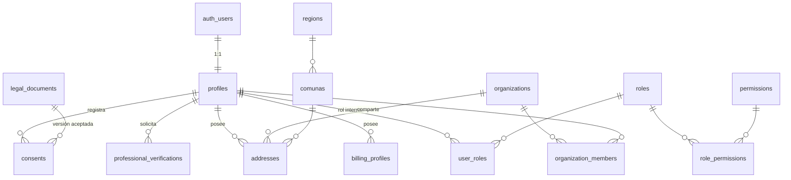
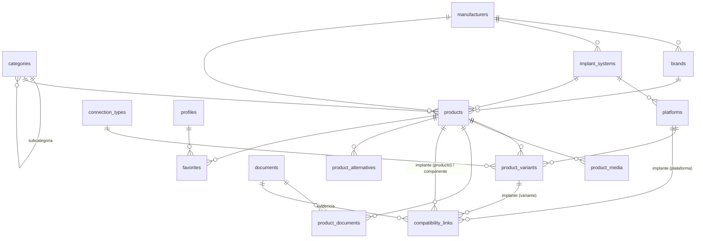
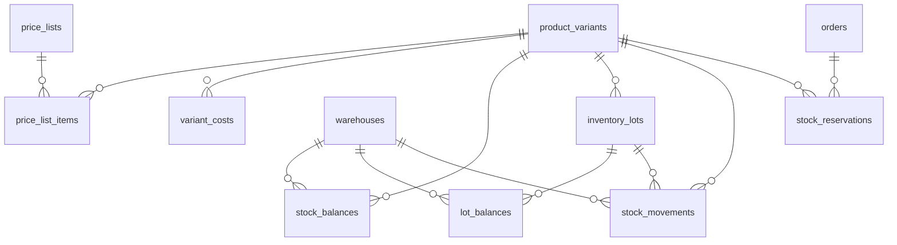
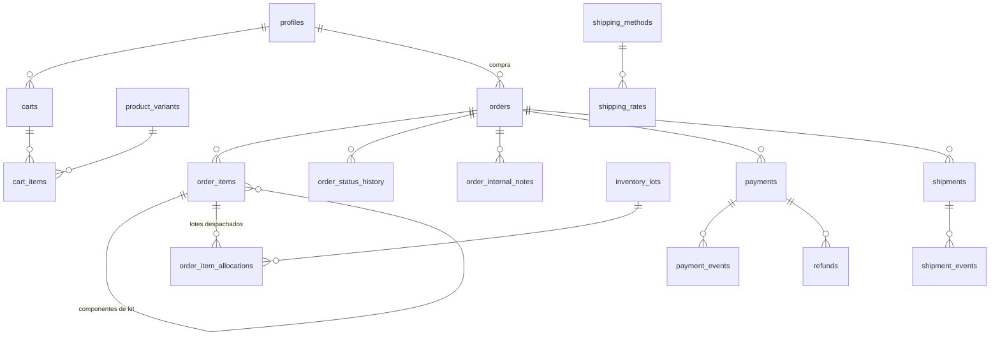
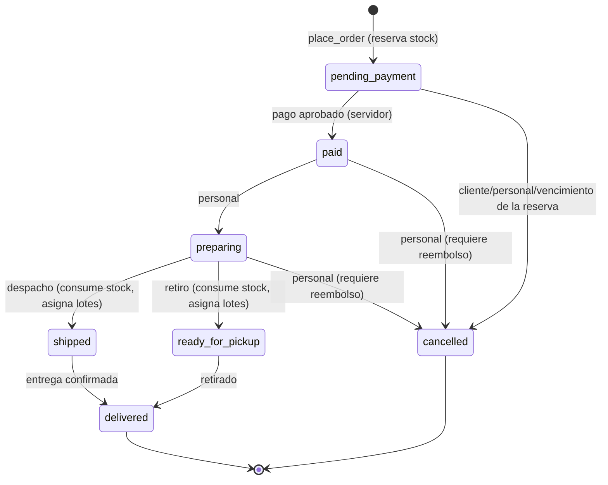

# Modelo de datos

Versión 0.1 — 2026-10-28. Las tablas marcadas **MVP** se implementan en las migraciones iniciales (`supabase/migrations`). Las marcadas **F4…F7** están diseñadas aquí para no forzar rediseños, pero se crearán en su fase.

## 1. Convenciones

- PostgreSQL 15+ (Supabase usa 17; las pruebas locales corren en 16; no se usan funciones exclusivas de 17).
- Claves primarias `uuid` (`gen_random_uuid()`), salvo los catálogos de códigos (`text`) y los libros de alto volumen (`bigint identity`).
- Fechas `timestamptz` en UTC; la presentación se hace en `America/Santiago`.
- **Dinero**: `bigint` en pesos chilenos (CLP no tiene decimales). Columna `currency char(3)` donde aplica. Costos de proveedor en otra moneda con `numeric(14,4)` y tipo de cambio registrado.
- Estados como `text` con `CHECK` (fáciles de evolucionar con una migración). Listas administrables como tablas (categorías, marcas, conexiones…).
- Nada se borra físicamente si tiene historial: se usa `status`/`archived_at`. Los libros (auditoría, movimientos de stock, eventos de pago) son **solo inserción**.
- Esquemas: `public` (expuesto por la API con RLS), `private` (funciones auxiliares e internas, no expuesto).
- Toda tabla de `public` tiene RLS habilitado. Ver [04-matriz-de-permisos.md](04-matriz-de-permisos.md).

## 2. Identidad, cuentas y organizaciones

| Tabla | Fase | Descripción y columnas clave |
|---|---|---|
| `profiles` | MVP | 1:1 con `auth.users`. `full_name`, `phone`, `account_type` (`general`, `dentist`, `implantologist`, `clinic`, `commercial`), `professional_status` (`not_requested`, `pending`, `verified`, `rejected`), `rut`. El usuario solo puede actualizar columnas personales (privilegios por columna); los estados los cambia el personal. Se crea con un trigger al registrarse. |
| `legal_documents` | MVP | Versiones de términos y privacidad: `kind`, `version`, `url`, `published_at`, `is_current`. El texto lo provee un asesor legal. |
| `consents` | MVP | Historial **solo inserción** de consentimientos: `consent_type` (`terms`, `privacy`, `marketing_email`, `marketing_push`, `marketing_whatsapp`), `granted`, `legal_document_id`, `source`, `created_at`. El estado vigente es el último registro por tipo. |
| `professional_verifications` | MVP | Solicitud de verificación: `profession`, `rut`, `registry_number` (Registro Nacional de Prestadores Individuales de Salud), `document_paths`, `status` (`pending`, `approved`, `rejected`), `reviewed_by`, `reviewed_at`, `review_notes`. |
| `addresses` | MVP | Dirección de despacho del usuario (o de la organización en F4): `recipient_name`, `phone`, `street`, `street_number`, `unit`, `comuna_code`, `reference`, `is_default`, `archived_at`. |
| `billing_profiles` | MVP | Datos de facturación: `rut`, `business_name`, `giro`, `address_line`, `comuna_code`, `dte_email`. |
| `regions`, `comunas` | MVP | Referencia territorial con los códigos oficiales (CUT). |
| `roles`, `permissions`, `role_permissions`, `user_roles` | MVP | Roles internos configurables y permisos explícitos (`recurso.acción`). |
| `organizations` | MVP (modelo) / F4 | Clínica u organización comercial: `kind`, `legal_name`, `trade_name`, `rut` (único), `giro`, `status`. |
| `organization_members` | MVP (modelo) / F4 | `role` (`clinic_admin`, `dentist`, `assistant`, `purchaser`), `requires_approval`, `status`. |
| `purchase_requests`, `purchase_request_events` | F4 | Solicitudes de pedido con aprobación: quién creó, modificó y aprobó. |

## 3. Catálogo y compatibilidad

| Tabla | Fase | Descripción y columnas clave |
|---|---|---|
| `categories` | MVP | Árbol (`parent_id`), `slug`, `name`, `sort_order`, `is_active`. Semilla: las 12 categorías de la especificación. |
| `manufacturers`, `brands` | MVP | Fabricantes y marcas (una marca pertenece opcionalmente a un fabricante). |
| `implant_systems` | MVP | Sistema de implantes de un fabricante. |
| `platforms` | MVP | Plataforma protésica de un sistema (`code`, `name`, `diameter_mm` opcional). |
| `connection_types` | MVP | Tipos de conexión administrables. |
| `products` | MVP | Modelo comercial: `category_id`, `brand_id`, `manufacturer_id`, `implant_system_id`, `product_kind` (`implant`, `abutment`, `transfer`, `screw`, `analog`, `healing_abutment`, `biomaterial`, `instrument`, `surgical_kit`, `prosthetic`, `general_supply`, `other`), `name`, `slug`, `description`, `usage_instructions`, `storage_conditions`, `tax_class` (`iva`, `exempt`), `tracks_lots`, `tracks_expiry`, `requires_professional`, `status` (`draft`, `published`, `archived`), `is_featured`, `attributes jsonb`, columnas de búsqueda mantenidas por trigger. |
| `product_variants` | MVP | Unidad vendible: `sku` (único sin distinguir mayúsculas), `manufacturer_ref`, `gtin` (único), `label`, `diameter_mm`, `length_mm`, `platform_id`, `connection_type_id`, `attributes jsonb`, `status` (`active`, `inactive`, `discontinued`), códigos normalizados para buscar sin guiones ni espacios. |
| `product_media` | MVP | Fotos en Storage: `storage_path`, `alt_text`, `sort_order`, `variant_id` opcional. |
| `documents` | MVP | Documentos técnicos (ficha, instrucciones de uso, certificado, catálogo del fabricante): `kind`, `title`, `storage_path` o `external_url`, `version`, `visibility` (`public`, `customers`, `internal`). También sirven como **evidencia** de compatibilidad. |
| `product_documents` | MVP | Relación N:M producto–documento. |
| `attribute_definitions` | MVP | Definición de atributos técnicos flexibles: `code`, `label`, `data_type`, `unit`, `applies_to_kinds`, `is_filterable`, `is_comparable`. El comparador solo compara atributos con la misma definición y unidad. |
| `compatibility_links` | MVP | **Compatibilidad explícita**. Lado implante según `implant_scope`: `variant` (`implant_variant_id`), `product` (`implant_product_id`) o `platform` (`platform_id`). Lado componente: `component_product_id` (+ `component_variant_id` opcional). `status` (`pending`, `verified`, `rejected`, `retired`). Evidencia: `evidence_type`, `evidence_document_id`, `evidence_reference`, `verified_at`, `verified_by`. Un `CHECK` impide `verified` sin evidencia, fecha y responsable. |
| `product_alternatives` | MVP (modelo) / F4 | Alternativa **comercial** aprobada (no implica compatibilidad): `product_id`, `alternative_product_id`, `status`, `approved_by`, `notes`. |
| `favorites` | MVP | Favoritos del usuario (`user_id`, `product_id`). |
| `kits`, `kit_items` | F4 | Kits predefinidos (administrador) y personalizados (usuario): `owner_user_id`/`organization_id`, `is_template`, ítems con `variant_id` y `quantity`. **Sin stock propio.** |
| `shopping_lists`, `shopping_list_items`, `shopping_list_shares` | F4 | Listas habituales o por procedimiento, compartibles. |

### 3.1 Regla de compatibilidad

Un componente C es **compatible verificado** con una variante de implante V si existe un `compatibility_links` con `status = 'verified'` y además:

- `implant_scope = 'variant'` y `implant_variant_id = V`, o
- `implant_scope = 'product'` y `implant_product_id = producto(V)`, o
- `implant_scope = 'platform'` y `platform_id = plataforma(V)`.

Y el componente coincide (`component_variant_id` = la variante consultada, o es nulo y `component_product_id` = su producto). Si existe un vínculo `rejected` que aplica, el resultado es **incompatible verificado**. En cualquier otro caso es **pendiente de verificación**. No hay inferencia por medidas ni por marca.

## 4. Precios, costos e inventario

| Tabla | Fase | Descripción y columnas clave |
|---|---|---|
| `price_lists` | MVP | `code`, `name`, `kind` (`base`, `customer`, `organization`, `tier`), `is_default` (una sola), `valid_from`, `valid_to`, `status`. |
| `price_list_items` | MVP | `price_list_id`, `variant_id`, `min_quantity` (tramos por volumen), `unit_price_net` (CLP). Historial mediante auditoría. |
| `price_list_assignments` | F4 | Asignación de listas a usuarios u organizaciones, con prioridad. |
| `variant_costs` | MVP | Costo de adquisición: `supplier_id`, `unit_cost`, `cost_currency`, `exchange_rate`, `unit_cost_clp`, `valid_from`, `source`. **Solo visible con `costs.read`.** |
| `promotions`, `coupons`, `coupon_redemptions` | F4 | Descuentos porcentuales o por monto, volumen, packs, vigencias, límites de uso y margen mínimo. |
| `warehouses` | MVP | Bodegas: `code`, `name`, `comuna_code`, `is_sellable` (cuenta para la venta en línea), `is_pickup_point`, `priority` (orden de asignación). |
| `stock_balances` | MVP | Por (variante, bodega): `on_hand`, `reserved`, `committed`. `CHECK (on_hand >= 0 AND reserved >= 0 AND committed >= 0 AND reserved + committed <= on_hand)`. |
| `inventory_lots` | MVP | `variant_id`, `lot_number` (único por variante), `expiry_date`, `supplier_id`, `received_at`, `status` (`available`, `quarantine`, `recalled`, `expired`), `document_id`. |
| `lot_balances` | MVP | Por (lote, bodega): `on_hand`, `location`. Para las variantes con lote, Σ lotes = `stock_balances.on_hand` (lo garantizan las funciones de inventario y lo verifica una prueba). |
| `stock_movements` | MVP | Libro inmutable: `movement_type` (`receipt`, `adjustment`, `sale_dispatch`, `return_restock`, `transfer_out`, `transfer_in`, `write_off`), `quantity` con signo, `reason`, `reference_type`/`reference_id`, `actor_id`, `on_hand_after`. |
| `stock_reservations` | MVP | `order_id`, `variant_id`, `warehouse_id`, `quantity`, `status` (`active`, `committed`, `consumed`, `released`), `expires_at`. |
| `inventory_transfers`, `inventory_counts` | F5 | Transferencias entre bodegas y conteos con diferencias. |

### 4.1 Definiciones de stock

- **Disponible para la venta** de la variante V = Σ sobre las bodegas `is_sellable` de (`on_hand − reserved − committed`).
- **Reservar** (pedido creado): `reserved += q` en la bodega de mayor prioridad con saldo; si no alcanza, se reparte entre bodegas.
- **Comprometer** (pago aprobado): `reserved −= q`, `committed += q`.
- **Despachar**: `committed −= q`, `on_hand −= q`, con movimiento `sale_dispatch` y asignación de lotes (FEFO por defecto, o el lote escaneado).
- **Liberar** (cancelación o vencimiento de la reserva): `reserved −= q`.

## 5. Carrito, pedidos, pagos y despacho

| Tabla | Fase | Descripción y columnas clave |
|---|---|---|
| `carts` | MVP | Un carrito `active` por usuario (índice único parcial). `status` (`active`, `converted`, `abandoned`), `converted_order_id`, `last_activity_at`. |
| `cart_items` | MVP | `variant_id`, `quantity` (1–999). **No guarda precios**: se calculan en el servidor al cotizar. |
| `shipping_methods` | MVP | `code` (`pickup`, `standard`, `priority`), `name`, `requires_address`, `is_active`. |
| `shipping_rates` | MVP | Tarifa por método y comuna (o región, o tarifa general): `price_net`, `free_over_net`, `est_days_min`, `est_days_max`. Sin tarifa = sin cobertura. |
| `orders` | MVP | `order_number` (legible), `user_id`, `organization_id`, `status`, `payment_status`, `fulfillment_status`, `document_type` (`boleta`, `factura`), `price_mode`, montos (`subtotal_net`, `discount_net`, `shipping_net`, `taxable_net`, `exempt_net`, `tax_rate`, `tax_amount`, `total`), snapshots JSON de facturación, dirección y método de despacho, `estimated_delivery_min/max` (**estimación**), `idempotency_key` (única por usuario), `reservation_expires_at`, `source_channel`, `quote_id` (F4), fechas. |
| `order_items` | MVP | **Snapshot inmutable**: `sku`, `manufacturer_ref`, `name`, `variant_label`, `quantity`, `unit_price_net`, `unit_price_gross`, `discount_net`, `line_net`, `tax_class`, `line_total`, `price_list_id`, `item_type` (`product`, `kit`, `kit_component`), `parent_item_id`. Un trigger impide modificar los ítems. |
| `order_status_history` | MVP | `from_status`, `to_status`, `changed_by`, `reason`, `created_at`. |
| `order_internal_notes` | MVP | Notas solo visibles para el personal. |
| `order_item_allocations` | MVP | Lote y bodega despachados por ítem: base de la **trazabilidad de lotes** (qué pedidos contienen el lote X). |
| `payments` | MVP | `provider`, `method`, `status`, `amount`, `currency`, `buy_order` (referencia propia), `provider_token`, `provider_transaction_id`, `authorization_code`, `card_last4`, `installments`, `response_code`, `failure_reason`, `approved_at`. Sin PAN ni CVV. |
| `payment_events` | MVP | Libro de eventos/webhooks: `provider`, `provider_event_id` (único por proveedor), `signature_valid`, `payload` saneado, `processed_at`, `result`. Solo personal. |
| `refunds` | MVP (modelo) / F6 | `amount`, `status`, `provider_refund_id`, `reason`, `requested_by`, `approved_by`. |
| `shipments` | MVP | `carrier`, `tracking_number` (**solo si es real**), `tracking_url`, `status`, `estimated_delivery_date` (estimación), `delivered_at` (confirmado). |
| `shipment_events` | MVP | Historial de estados: `source` (`staff`, `carrier_api`). |
| `invoices` (DTE) | F6 | `order_id`, `dte_type`, `folio`, `provider_id`, `status`, `pdf_path`. Solo con una integración real. |

### 5.1 Máquina de estados del pedido

`payment_status`: `unpaid` → `paid` → (`partially_refunded` | `refunded`).
`fulfillment_status`: `unfulfilled` → `fulfilled` (→ `partially_returned` | `returned` en F6).

**Pago tardío**: si llega un pago aprobado para un pedido cancelado por vencimiento, se intenta reservar de nuevo. Si hay stock, el pedido pasa a `paid`. Si no, queda cancelado y se crea automáticamente una solicitud de reembolso para el personal.

### 5.2 Máquina de estados del pago

`created` → `pending` → (`approved` | `rejected` | `cancelled` | `expired` | `error`); `approved` → (`partially_refunded` | `refunded`). Los estados finales no retroceden. Repetir el mismo resultado no tiene efectos (idempotente).

## 6. Módulos posteriores (diseño resumido)

| Módulo | Tablas | Fase |
|---|---|---|
| Cotizaciones | `quotes` (número, vigencia, condiciones, snapshot de cliente, estado: `draft`, `sent`, `approved`, `rejected`, `expired`, `converted`), `quote_items` (snapshot de precios), `quote_events`. `orders.quote_id` mantiene la trazabilidad al convertir. | F4 |
| Compras recurrentes | `recurring_orders` (frecuencia, próxima ejecución, estado), `recurring_order_items`, `recurring_order_runs` (resultado de la revalidación y notificación). Sin cobro automático sin autorización. | F4 |
| Proveedores y compras | `suppliers`, `supplier_products` (costo, plazo, mínimo), `purchase_orders` (estado: `draft`, `pending_approval`, `approved`, `sent`, `partially_received`, `received`, `cancelled`), `purchase_order_items`, `goods_receipts`, `goods_receipt_items` (cantidades escaneadas, lote, vencimiento, diferencias). | F5 |
| Alertas | `stock_alert_subscriptions` (cliente), `price_alert_subscriptions`, `admin_alert_rules`, `alert_events` (deduplicación por clave). | F6 |
| Notificaciones | `notifications` (bandeja), `notification_preferences`, `push_tokens`, `notification_deliveries` (estado reportado por el proveedor), `outbox_events`. | F6 |
| Soporte | `support_tickets`, `support_messages`, `support_attachments`. | F6 |
| Devoluciones | `return_requests`, `return_items` (lote, cantidad, decisión), `return_events`. El reingreso pasa por cuarentena. | F6 |
| CRM | `crm_contacts`, `crm_opportunities`, `crm_activities` (incluye «WhatsApp abierto» registrado por el personal), `crm_tasks`. | F6 |
| Inteligencia comercial | Vistas y vistas materializadas de ventas, márgenes y rotación; `sales_goals`, `commission_rules` (restringido). | F7 |
| Fidelización y opiniones | `customer_tiers`, `tier_assignments`, `referrals`, `product_reviews`, `review_reports`. | F7 |

## 7. Auditoría y configuración

| Tabla | Fase | Descripción |
|---|---|---|
| `audit_log` | MVP | Solo inserción. `occurred_at`, `actor_id`, `actor_role`, `action`, `table_name`, `record_id`, `old_data`, `new_data` (sin columnas sensibles), `context`. Se llena con triggers en productos, variantes, precios, costos, compatibilidades, pedidos, pagos, roles y configuración. |
| `app_settings` | MVP | Configuración clave/valor (`jsonb`) con `is_public`: visibilidad del catálogo y de los precios, tasa de IVA, minutos de reserva, prefijo de pedidos, exigencia de MFA para el personal, umbral de stock bajo, versión mínima de la app, contacto de WhatsApp y horarios. |
