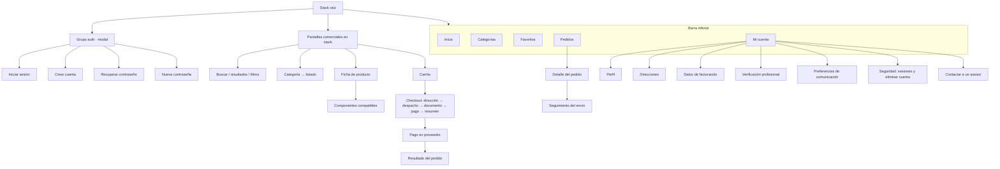

# Mapa de pantallas

Versión 0.1 — 2026-10-28. Fase indicada por pantalla. Regla general: **una pantalla solo se incluye en la navegación cuando su funcionalidad está conectada al backend real**. Todas las pantallas implementan los estados de *carga*, *error* (con opción de reintentar), *vacío* (con explicación) y *sin conexión*.

## 1. App móvil (iOS / Android)

### 1.1 Estructura de navegación

El **carrito** se abre desde un ícono con contador en el encabezado de Inicio, Categorías, resultados de búsqueda y la ficha de producto. Solo se muestra cuando el usuario tiene sesión, porque el carrito es del servidor ([D-06](07-decisiones-pendientes.md)).

### 1.2 Pantallas

| Pantalla | Propósito | Datos (fuente) | Acciones principales | Fase |
|---|---|---|---|---|
| **Inicio** | Puerta de entrada comercial | Categorías activas, productos destacados publicados (`products.is_featured`) | Buscar, abrir categoría, abrir producto, carrito | F2 (estructura) / F3 (datos) |
| **Categorías** | Explorar el árbol de categorías | `categories` | Abrir subcategoría o listado | F2/F3 |
| **Listado por categoría** | Productos de una categoría y sus descendientes | RPC `search_catalog` | Filtrar, ordenar, abrir producto | F3 |
| **Buscar** | Buscador inteligente | Búsquedas recientes (dispositivo), sugerencias (RPC) | Escribir texto, código o medidas; filtros | F3 |
| **Resultados y filtros** | Resultados combinables | RPC `search_catalog` | Filtros: categoría, marca, fabricante, sistema, plataforma, conexión, diámetro, longitud y disponibilidad. Orden | F3 |
| **Escáner de envase** | Leer GS1/UDI con la cámara | Cámara, RPC de búsqueda por GTIN/código | Confirmar la coincidencia, pasar a búsqueda manual | F3 (BUS-07) |
| **Ficha de producto** | Información técnica y compra | Producto, variantes, medios, documentos, precio (RPC), disponibilidad (RPC) | Elegir variante (diámetro × longitud), agregar al carrito, favorito, documentos, asesor por WhatsApp | F3 |
| **Componentes compatibles** | Compatibilidades verificadas de la variante elegida | RPC `get_compatible_components` | Ver la evidencia (fuente, fecha), abrir el componente. Si no hay datos: «pendiente de verificación» | F3 |
| **Favoritos** | Productos guardados | `favorites` | Abrir, quitar | F3 |
| **Carrito** | Revisar la compra | RPC `get_cart_summary` (precios, IVA, disponibilidad del servidor) | Cambiar cantidades, eliminar, ir al checkout, asesor | F4 (MVP) |
| **Checkout** | Pasos: dirección, despacho (tarifas por comuna), boleta o factura, medio de pago y resumen | `addresses`, `shipping_rates`, `billing_profiles`, RPC de cotización | Confirmar (RPC `place_order` idempotente) | MVP |
| **Pago** | Redirección al proveedor | Edge Function de pagos | Pagar en el sitio o la app del proveedor | MVP (requiere [D-03](07-decisiones-pendientes.md)) |
| **Resultado del pedido** | Estado **real** consultado al servidor | `orders`, `payments` | Ver el pedido, reintentar el pago si sigue vigente | MVP |
| **Pedidos** | Historial permanente | `orders` (RLS: solo los propios) | Abrir el detalle | F3 (lectura) / MVP |
| **Detalle del pedido** | Ítems con precios históricos, totales, pago, dirección, modalidad, documentos | `orders`, `order_items`, `payments`, `shipments` | Seguimiento, asesor, cancelar (si está pendiente de pago); comprar nuevamente (F4) | MVP |
| **Seguimiento** | Estados del envío | `shipments`, `shipment_events` | Abrir la URL del transportista (si es real) | MVP |
| **Mi cuenta** | Centro de la cuenta | `profiles` | Navegar a las subpantallas, cerrar sesión | F3 |
| **Perfil** | Datos personales y profesionales | `profiles` | Editar | F3 |
| **Direcciones** | Despacho | `addresses`, `comunas` | Crear, editar, archivar, marcar predeterminada | F3 |
| **Facturación** | RUT, razón social, giro | `billing_profiles` | Crear, editar (con validación de RUT) | F3 |
| **Verificación profesional** | Enviar antecedentes | `professional_verifications`, Storage | Enviar la solicitud y ver su estado | F3 |
| **Preferencias de comunicación** | Consentimientos por canal | `consents` | Activar o desactivar (historial) | F3 |
| **Seguridad** | Sesiones y eliminación de cuenta | Auth | Cerrar sesión en todos los dispositivos, eliminar la cuenta (con confirmación) | F3 |
| **Iniciar sesión / Crear cuenta / Recuperar** | Autenticación | Supabase Auth | Registro con términos y consentimientos, verificación de correo, enlace de recuperación | F3 |
| **Cotizaciones** (lista, detalle, PDF) | Cotizaciones del cliente | `quotes` | Descargar o compartir el PDF, aceptar, convertir en pedido | F4 |
| **Kits y listas** | Armador de kits y listas por procedimiento | `kits`, `shopping_lists` | Crear, duplicar, compartir, agregar al carrito | F4 |
| **Pedidos programados** | Compras recurrentes | `recurring_orders` | Programar, pausar, revisar antes de ejecutar | F4 |
| **Clínica** | Miembros y aprobaciones | `organization_members`, `purchase_requests` | Invitar, asignar rol, aprobar o rechazar | F4 |
| **Notificaciones** | Bandeja | `notifications` | Marcar leído, preferencias | F6 |
| **Soporte** | Tickets | `support_tickets` | Crear, responder, adjuntar | F6 |
| **Devoluciones** | Solicitudes desde un pedido | `return_requests` | Solicitar, adjuntar fotos, ver la resolución | F6 |

## 2. Tienda web (F8)

Mismas capacidades comerciales que la app: inicio, categorías, búsqueda, ficha (con URL indexable por `slug`), compatibilidades, carrito, checkout, cuenta e historial. Usa las mismas RPC y la misma lógica de dominio.

## 3. Panel administrativo (Next.js)

Diseño responsive: barra lateral en escritorio y menú desplegable en tablet o móvil. Cada sección se muestra solo si el usuario tiene el permiso correspondiente; **el backend vuelve a validarlo**.

| Sección | Pantallas | Permiso base | Fase |
|---|---|---|---|
| Acceso | Inicio de sesión del personal, enrolamiento y verificación MFA (TOTP) | personal interno | MVP |
| Inicio | Resumen operativo: pedidos por estado, stock bajo, verificaciones pendientes | `orders.read` | MVP |
| Catálogo | Productos (lista, filtros, crear, editar, duplicar, archivar), variantes, fotos, documentos, categorías, marcas, fabricantes, sistemas, plataformas, conexiones, atributos | `catalog.*` | MVP |
| Compatibilidades | Lista por implante o componente, crear un vínculo, adjuntar evidencia, verificar o rechazar | `compatibility.*` | MVP |
| Precios | Lista base, tramos por volumen, historial | `prices.*` | MVP |
| Inventario | Stock por variante y bodega, movimientos, ingreso manual, ajuste con motivo, lotes y vencimientos, bodegas | `inventory.*` | MVP |
| Pedidos | Lista, detalle, cambio de estado validado, notas internas, despacho con asignación de lotes | `orders.*`, `shipments.*` | MVP |
| Pagos | Pagos y eventos por pedido, confirmación manual de transferencias (si se aprueba) | `payments.*` | MVP |
| Despacho | Métodos, tarifas por comuna o región, envíos y seguimiento | `shipments.*`, `settings.update` | MVP |
| Clientes | Personas, verificación profesional (revisar y aprobar), organizaciones | `customers.*`, `verifications.review` | MVP |
| Usuarios y roles | Asignar roles internos, ver permisos | `users.manage_roles` | MVP |
| Auditoría | Búsqueda en el registro de auditoría | `audit.read` | MVP |
| Configuración | Visibilidad, IVA, reserva, WhatsApp, horarios, versión mínima de la app, documentos legales | `settings.*` | MVP |
| Importación y exportación | Plantillas CSV/Excel del catálogo, informe de errores | `catalog.import` / `catalog.export` | MVP |
| Cotizaciones, promociones, kits | — | — | F4 |
| Proveedores, órdenes de compra, recepción con escáner | — | — | F5 |
| CRM, soporte, devoluciones, notificaciones | — | — | F6 |
| Reportes, BI, metas, calendario, calculadora | — | — | F7 |

## 4. Lineamientos de UX

- **Identidad**: paleta configurable de azul profundo, blanco y turquesa (`packages/brand`). El turquesa se usa para acentos y fondos, no como color de texto sobre blanco (contraste insuficiente). Existe una variante oscura accesible.
- **Tipografía**: fuentes del sistema (San Francisco en iOS, Roboto en Android): modernas, legibles y sin costo de carga. Escala tipográfica definida en el tema.
- **Componentes**: botones con estados (normal, presionado, deshabilitado, cargando), tarjetas de producto, insignias de estado (disponible, últimas unidades, agotado, solo profesionales), estados vacíos y de error con acción, y *skeletons* de carga.
- **Formularios**: validación inmediata y clara (zod compartido), teclado adecuado por campo (correo, teléfono, numérico) y autocompletado.
- **Accesibilidad**: etiquetas `accessibilityLabel`, áreas táctiles de 44 pt o más, contraste AA y soporte de texto dinámico.
- **Animaciones**: sutiles (transiciones nativas y respuesta al tocar). Se respeta la opción del sistema de «reducir movimiento».
- **Precios**: CLP con separador de miles («$12.990»). Se indica si el precio incluye IVA. Los precios que el usuario no puede ver se reemplazan por «Inicia sesión para ver precios» o «Precio para profesionales verificados», según la configuración.
- **Honestidad del estado**: los plazos se rotulan como «estimado». «WhatsApp abierto» no es «mensaje enviado». «Compatibilidad pendiente de verificación» no es «compatible».
